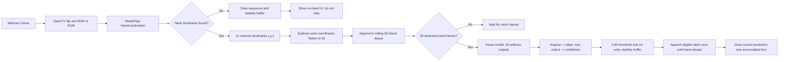

# Accessible Sign Language Translator — Project Understanding

This document describes the repository as inspected on **31 October 2026**. It distinguishes what the checked-in source implements from what has actually been tested. It is an engineering guide, not a claim that the model is accurate for every signer or environment.

## 1. Project Overview

### Problem and motivation

The project explores recognizing hand shapes from a webcam and displaying predicted alphabet letters. Its motivation is to make a small assistive-technology demonstration for people communicating with Indian Sign Language (ISL), including deaf and hard-of-hearing users.

### Objective and intended users

The implemented objective is narrower than a general translator: detect one hand, extract its landmarks, and classify a rolling sequence into one of 26 labels, `A` through `Z`. A user can hold a pose in front of the camera and see a predicted letter added to an on-screen text string.

The program is currently a desktop prototype for a user with a webcam. It does not provide speech output, a mobile app, or a full communication interface.

### Scope and limitations

- The runtime uses `num_hands=1`; it processes one detected hand.
- The model has 26 alphabet outputs. There is no word, sentence, grammar, or natural-language translation model.
- The application has no explicit “unknown sign” class. It selects one of A–Z for every model prediction, with a confidence threshold used only to decide whether to append it.
- The local `data/` directory was absent at inspection time. The scripts support collecting or generating data, but there are no local raw training examples to inspect.
- Real-world accuracy, supported sign variations, and performance across users, lighting, cameras, and backgrounds need evaluation.

### Alphabet recognition versus continuous sign-language translation

Alphabet recognition classifies an isolated or held hand pose as a letter. Continuous sign-language translation must handle a stream of signs, motion, transitions, facial/body cues, word boundaries, and language-specific grammar to produce words or sentences. This repository implements the former, not the latter. The displayed string is a sequence of predicted letters; it is not evidence that the system understands or translates continuous ISL.

## 2. Current Project Status

| Component | Status | Evidence / qualification |
|---|---|---|
| Webcam inference script | Implemented | `3_realtime_predict.py` opens camera index 0, processes frames, and displays a window. The user previously observed the camera opening and landmarks being drawn. |
| Model loading and prediction | Implemented and tested with the project venv | The saved model loaded through the application’s TensorFlow Keras API; observed shapes were `(None, 30, 63)` and `(None, 26)`. A zero-input prediction had shape `(1, 26)` with finite values summing to 1. This tests loading and execution, not visual-sign accuracy. |
| MediaPipe hand landmarks | Implemented and API checked | The script configures a MediaPipe Tasks hand landmarker. The installed API symbols and image construction worked in a focused check. |
| Hand-release / repeated-letter fix | Implemented; live behavior needs verification | The code records `last_appended`, blocks appending the same label while held, and resets that state when no hand is detected. No post-change webcam test has been reported. |
| No-hand inference gate | Implemented; live behavior needs verification | No-hand frames clear the sequence and candidate buffer; inference resumes after 30 detected-hand frames. The “no hand” UI condition now uses `bool(res.hand_landmarks)`. |
| Data collection | Implemented, not tested as a complete workflow here | `1_collect_data.py` has webcam capture logic, but a full collection session was not run. |
| Training on collected data | Implemented, not tested as a complete workflow here | `2_train_model.py` loads local `.npy` sequences and trains/saves model and encoder. No local `data/` directory was present. |
| Synthetic-data generation and training | Implemented, not tested as a complete workflow here | `generate_and_train.py` synthesizes sequences and trains. Running it writes into `data/raw/` and overwrites named model outputs. |
| Recognition quality / accuracy | Needs verification | No independently labelled real-world evaluation was run. The README’s “88%+” badge/table is not established by the checks described here. |
| Text-to-speech, word recognition, two-hand support, web/mobile interface | Planned / not implemented | Listed as possible future contribution ideas in `README.md`; no corresponding runtime module is present. |

The repeated-sign fix is a duplicate-entry behavior change. It does **not** make an incorrect model prediction correct or improve model accuracy.

## 3. Complete Repository and File Structure

The tracked root files and model files are listed below. `venv/` and `model/hand_landmarker.task` were present locally but untracked at inspection time. The local `data/` directory did not exist. No root `.gitignore`, `pyproject.toml`, `setup.cfg`, or other Python project configuration file was found.

```text
Indian-SignLanguage-Translator/
├── 1_collect_data.py
├── 2_train_model.py
├── 3_realtime_predict.py
├── generate_and_train.py
├── requirements.txt
├── README.md
├── install_windows.bat
├── install_linux_mac.sh
├── LICENSE
├── PROJECT_UNDERSTANDING.md      # this document
├── model/
│   ├── isl_lstm_model.keras
│   ├── label_encoder.pkl
│   ├── hand_landmarker.task       # present locally; untracked
│   └── training_history.png
├── data/                          # not present locally at inspection
│   └── raw/<LETTER>/<N>.npy       # created by collection/generation scripts
└── venv/                          # local Python environment; untracked
```

### Important files

| File | Purpose, inputs, and outputs | Required for current webcam application? |
|---|---|---|
| [`1_collect_data.py`](./1_collect_data.py) | Opens a webcam, detects landmarks, and saves each recorded 30-frame sample as `data/raw/<LETTER>/<N>.npy`. Defaults to all A–Z; `--letters` and `--sequences` can narrow/change collection. It can download `model/hand_landmarker.task`. | No, not for inference if model, encoder, and task asset already exist. Needed to collect real samples. |
| [`2_train_model.py`](./2_train_model.py) | Reads correctly shaped `.npy` files under `data/raw/`, label-encodes folder names, splits data, trains the LSTM, evaluates on its held-out split, then writes `model/isl_lstm_model.keras`, `model/label_encoder.pkl`, and `model/training_history.png`. | No, not for inference. Running it writes/overwrites model artifacts. |
| [`3_realtime_predict.py`](./3_realtime_predict.py) | Loads the model and label encoder, initializes MediaPipe and webcam, performs rolling-window predictions, draws landmarks/UI, and accumulates letters. | **Yes**; this is the current webcam app. |
| [`generate_and_train.py`](./generate_and_train.py) | Creates hand-landmark-like synthetic sequences for A–Z, writes them under `data/raw/`, trains the same general LSTM architecture, and writes model, encoder, and plot. | No, not for inference. It is a training/bootstrap alternative and overwrites files with matching names. |
| [`requirements.txt`](./requirements.txt) | Lists dependencies and version constraints for package installation. | Needed to reproduce the Python environment, but not imported at runtime. |
| [`README.md`](./README.md) | Project overview, usage, architecture, claims, and contribution ideas. Some reported performance figures are not independently validated by this inspection. | No. |
| [`install_windows.bat`](./install_windows.bat) | Creates/activates `venv`, upgrades pip, installs requirements, then pauses. It invokes `python -m venv venv` unconditionally, so it is not the safest way to preserve an existing environment. | No; manual PowerShell setup is preferable for an existing venv. |
| [`install_linux_mac.sh`](./install_linux_mac.sh) | Unix-like setup equivalent: creates venv and installs requirements. | No; not for Windows. |
| [`model/isl_lstm_model.keras`](./model/isl_lstm_model.keras) | Saved Keras model configuration and learned weights. Its archive metadata reports Keras 3.14.1. | **Yes**. |
| [`model/label_encoder.pkl`](./model/label_encoder.pkl) | Serialized scikit-learn `LabelEncoder` whose `classes_` maps output index to letter. Inspection loaded 26 classes A–Z. | **Yes**. |
| [`model/hand_landmarker.task`](./model/hand_landmarker.task) | MediaPipe Tasks model asset used by `HandLandmarkerOptions`. It was present locally (7,819,105 bytes) but is untracked. | **Yes**. |
| [`model/training_history.png`](./model/training_history.png) | Image showing training and validation accuracy/loss curves. Both training scripts write a plot with these curves. The image itself does not establish which exact model or dataset/run produced it. | No. |
| `data/raw/<LETTER>/<N>.npy` | Per-sample arrays created by collection or synthetic generation. Each accepted sample is 30 × 63. | No for inference; required to run `2_train_model.py`. Not present locally at inspection time. |
| `venv/` | Local Python 3.11.9 environment. It was untracked in this worktree. | Required only as the chosen local runtime environment, not part of the app source. Do not commit it. |
| [`LICENSE`](./LICENSE) | MIT license text. | No. |

The scripts use imports rather than a separate application configuration system. No automated test files or CI configuration were found in the repository inventory.

## 4. Technology Stack

### Python and package versions

The active local environment was Python **3.11.9**. It is the version actually used for the checks recorded here; `requirements.txt` does not pin a Python version. The README badge says Python 3.9+, but that badge is not a tested compatibility matrix.

| Package | Installed in local venv | Requirement in `requirements.txt` | Use |
|---|---:|---|---|
| TensorFlow | 2.16.1 | `tensorflow==2.16.1` | Model training/inference runtime. |
| Keras | 3.14.1 | `keras==3.14.1` | Neural-network API and saved-model compatibility. |
| MediaPipe | 0.10.14 | `mediapipe>=0.10.0` | Tasks hand detector and 21 hand landmarks. |
| OpenCV (`opencv-python`) | 4.10.0.84 | `opencv-python>=4.8.0` | Webcam frames, color conversion, drawing, and window/key handling. |
| NumPy | 1.26.4 | `numpy>=1.24.0` | Landmark arrays, sequence buffers, and model inputs. |
| scikit-learn | 1.5.2 | `scikit-learn>=1.3.0` | `LabelEncoder` and training split. |
| joblib | 1.4.2 | `joblib>=1.3.0` | Saving/loading the label encoder. |
| Matplotlib | 3.9.2 | `matplotlib>=3.7.0` | Training-history plots. |

The model archive states Keras 3.14.1; TensorFlow 2.16.1 / Keras 3.14.1 successfully loaded it in this venv. Before that runtime adjustment, TensorFlow/Keras 2.15 failed on Keras 3 InputLayer configuration keys (`batch_shape`, `optional`). The current exact requirements pins reflect the tested model-loading combination.

**Version warning:** loading `label_encoder.pkl` under installed scikit-learn 1.5.2 emits `InconsistentVersionWarning`; the pickle identifies scikit-learn 1.8.0 as its serialization version. It loaded and exposed A–Z in the observed check, but sklearn warns that cross-version unpickling may be invalid. The requirement only says `>=1.3.0`, so it does not prevent this mismatch. Needs verification with the encoder-producing version or a deliberately compatible encoder artifact.

### Other technologies

- **LSTM (Long Short-Term Memory):** a recurrent neural-network layer that can use information across ordered frames. Here two LSTM layers process a 30-frame landmark sequence.
- **MediaPipe Tasks:** estimates hand landmark positions from an image. The runtime configures one hand in IMAGE mode.
- **OpenCV:** captures camera frames and handles basic image/window interaction.
- **NumPy:** represents each frame and the model batch as numeric arrays.
- **scikit-learn:** maps alphabet strings to integer targets for training and maps predicted output indices back to labels at runtime.
- **Matplotlib:** produces the training and validation accuracy/loss figure.
- **joblib:** serializes the fitted `LabelEncoder`.

## 5. End-to-End System Architecture



The live code is in `3_realtime_predict.py`. Landmark extraction is in `extract_landmarks`; model prediction and state logic are in `main`; drawing is in `draw_landmarks` and `draw_ui`. `1_collect_data.py` uses matching landmark coordinate processing for captured training examples.

## 6. Detailed Runtime Workflow

1. **Check required assets.** `main()` checks for `model/isl_lstm_model.keras`, `model/label_encoder.pkl`, and `model/hand_landmarker.task`. If one is absent it prints a missing-file message and returns.
2. **Load model and labels.** `keras.models.load_model(MODEL_PATH)` loads the saved network. `joblib.load(ENCODER_PATH)` loads the encoder. The console prints the number and names of classes.
3. **Configure MediaPipe.** `HandLandmarkerOptions` points at the task asset, sets `running_mode=IMAGE`, and sets `num_hands=1`.
4. **Open the webcam.** `cv2.VideoCapture(0)` selects camera index 0. If `isOpened()` is false, the app prints `Cannot open webcam` and returns. It requests 1280 × 720, but the camera/driver may choose another size.
5. **Read and mirror frames.** `cap.read()` returns a BGR frame. A successful frame is horizontally flipped with `cv2.flip(frame, 1)`. A failed read causes the loop to continue without inference.
6. **Convert and detect.** `extract_landmarks(frame, lm)` converts BGR to RGB and wraps the array as an SRGB MediaPipe `Image`. `lm.detect(...)` returns `res`.
7. **Build features.** If `res.hand_landmarks` is truthy, the first detected hand's 21 landmarks are read in MediaPipe order. For each landmark, the code takes `(p.x, p.y, p.z)` into a float32 array, subtracts the wrist row `c[0]` from every row, and flattens it. This produces 63 values. There is no additional scale normalization in this function.
8. **Check hand and form the sequence.** `hand_present = bool(res.hand_landmarks)`. If true, the 63-value frame is appended to `seq`, a `collections.deque(maxlen=30)`. Predictions wait until 30 detected-hand frames have been accumulated. Since a missing hand clears `seq`, a fresh complete 30-frame window is required after release. Once full, one new frame replaces the oldest frame on each subsequent camera frame.
9. **Predict.** `np.array(seq)` has shape `(30, 63)`; `np.expand_dims(..., 0)` makes a batch of shape `(1, 30, 63)`. The model returns 26 softmax values for the batch. `np.argmax(probs)` selects the largest output index; `enc.classes_[idx]` maps it to a letter. `float(probs[idx])` is displayed as the confidence.
10. **Apply threshold/stability and append.** A label enters `pred_buf` as itself only if confidence is `>= CONF_THRESH` (0.80); otherwise an empty string is inserted. `pred_buf` keeps at most 10 entries. `stab` counts entries equal to the current letter. The app appends only when the count reaches 10, current confidence is at least 0.80, the label differs from `last_appended`, and the `APPEND_DELAY` condition passes.
11. **Handle release.** When no hand is found, the code clears `seq` and `pred_buf`, resets the displayed prediction and confidence, and resets `last_appended`. This prevents prediction on a no-hand/mixed rolling window and allows a repeated letter after a release and new stable pose.
12. **Draw and interact.** `draw_landmarks` overlays connections and points. `draw_ui` displays sentence, prediction/confidence, stability dots, or “No hand detected”. `cv2.imshow` and `cv2.waitKey` process the window.
13. **Shut down.** On Q or ESC, the loop ends; the code releases the camera, destroys OpenCV windows, closes the landmarker, and prints the final sentence. Cleanup is explicit on normal key exit; exception-safe cleanup is not implemented with a `finally` block.

`cur_letter` and `cur_conf` remain blank/zero while waiting to refill after a release. `APPEND_DELAY` is 1.2 seconds. With the current `last_appended` rule, the same class cannot be appended twice while the hand remains continuously detected. Different stable labels can still be appended while the hand stays present, because the code only blocks the last appended label. This behavior needs a live interaction test.

## 7. Model and Machine Learning Concepts

### Saved model and architecture

The `.keras` file is a Keras archive containing model configuration and learned weights. Its metadata identifies Keras 3.14.1. It loaded with the current TensorFlow/Keras versions. The loaded model has:

- Input: `(None, 30, 63)`; `None` represents variable batch size.
- Output: `(None, 26)`.
- 166,746 parameters, as reported by the loaded model.
- Two LSTM layers (128 units returning sequences, then 64 units), BatchNormalization and Dropout layers, Dense layers of 128 and 64 units, and a 26-output softmax layer.

The architecture is also defined in `build_model()` in both training scripts. A successful load proves file parsing and model execution. It does not prove that the weights correctly recognize a sign made by a particular user.

### LSTM and temporal sequences

An LSTM processes ordered input values and maintains internal state across time steps. In this application each time step is one webcam frame represented by 63 landmark coordinates. The model was structured to classify a 30-frame sequence, rather than a single still image. The source does not establish that motion-based alphabet classes are modeled reliably; some of the synthetic generator's letter templates are approximations.

### Classes and label encoder

The output vector has 26 positions. The loaded encoder exposed classes `A` through `Z`, and the runtime selects `enc.classes_[idx]`. For example, if the largest output is at index 1 and the encoder at index 1 is `B`, the displayed candidate is B. The encoder is important: class index meaning must correspond to the training run that created the model.

### Confidence and stability

The final Dense layer uses `softmax`, so its 26 outputs are normalized class scores. The app calls the largest score `conf`. A score of 0.90 means the model assigned 0.90 to its top class among these outputs for that input; it is not a 90% guarantee of correctness or a calibrated probability of correctness.

`CONF_THRESH = 0.80` filters which top labels contribute as candidates. `STAB_FRAMES = 10` requires ten recent qualifying predictions to match the current label. These controls can reduce fleeting changes but cannot turn systematic misclassification into correct recognition. There is no “none of these signs” output.

### Training and data

`2_train_model.py`:

1. Scans sorted subdirectories of `data/raw/`, treating each directory name as a class.
2. Loads `.npy` files with shape `(30, 63)`; other shapes are ignored.
3. Converts sequences to float32 and labels to integer indices with `LabelEncoder`.
4. Uses `train_test_split(test_size=0.15, random_state=42, stratify=y)`.
5. Trains with Adam, sparse categorical cross-entropy, EarlyStopping, ReduceLROnPlateau, and ModelCheckpoint.
6. Evaluates on the held-out split, prints accuracy/loss and per-letter accuracy, then saves model, encoder, and plot.

The code passes the held-out split as `validation_data` to callbacks and later evaluates on the same split. Therefore that split is not an untouched independent final test set. Reported values from this script should be described as performance on its held-out validation/evaluation split, not as proven real-world accuracy.

`1_collect_data.py` obtains real sequences from the webcam and saves them under `data/raw/<LETTER>/`. It flips frames before feature extraction, matching inference. If a webcam read fails during a 30-frame sample, it inserts a zero vector for that frame; if detection finds no hand, `extract_landmarks` also returns a zero vector. Such samples can therefore include absent-hand frames.

`generate_and_train.py` generates synthetic coordinates using per-letter finger-state templates, noise, and simulated frame-to-frame tremor. It sets 80 sequences per class in this script and writes them under `data/raw/`, then splits and trains. Some letter templates are explicitly similar or approximated (for example J shares the I finger state, and Z is marked as a motion approximation). The README describes the included pretrained weights as synthetic; the generator is clearly synthetic. However, the saved `.keras` metadata alone does not establish the exact provenance of the present model. Treat “the current artifact was generated by this exact run” as **Needs verification**.

**Important overwrite risk:** both training paths save to the same `model/isl_lstm_model.keras`, `label_encoder.pkl`, and `training_history.png` names. The generator also writes `data/raw/<letter>/<0..79>.npy`. Run either training script only when intentionally replacing those outputs and after backing up any artifacts/data that must be preserved.

### Training history image

`training_history.png` visibly contains train/validation accuracy and loss curves. Both scripts create that kind of chart from in-memory `history.history`. The file does not identify the dataset, exact script invocation, or whether it belongs to the currently checked-in weights. Provenance: **Needs verification**.

## 8. Data Flow and Shapes

| Stage | Type / shape | Purpose |
|---|---|---|
| OpenCV frame | `uint8`, image height × width × 3, BGR | Camera image read by `cap.read()`; actual resolution is camera-dependent. |
| MediaPipe image | RGB/SRGB image, height × width × 3 | Input to `HandLandmarker.detect`. |
| One detected hand | 21 landmarks, each with x/y/z | Ordered point coordinates returned by MediaPipe. |
| One normalized landmark frame | float32 `(21, 3)`, then `(63,)` | Wrist coordinates are subtracted; 21 × 3 values flattened. |
| No-hand extraction result | float32 `(63,)` zeros | Returned by the shared extraction pattern. In the current inference loop this vector is ignored because `hand_present` is false and the buffers are cleared. |
| Rolling window | up to `(30, 63)` | Last 30 hand-present frame vectors. |
| Model batch | float32 `(1, 30, 63)` | Batch dimension added before prediction. |
| Model output | `(1, 26)` | Softmax scores for 26 class indices. |
| Selected result | integer `idx`, label string, scalar confidence | Argmax index maps through `enc.classes_`; max score is the confidence. |
| Training dataset | `(N, 30, 63)` with `N` valid samples | `load_dataset()` stacks correctly shaped sequences. |
| Training labels | strings then integer class IDs | Folder labels are encoded by `LabelEncoder`. |

## 9. Installation and Execution

### Verified local Windows environment

The active environment inspected for this document was Python 3.11.9 in `.\venv`, with TensorFlow 2.16.1, Keras 3.14.1, MediaPipe 0.10.14, OpenCV 4.10.0.84, and NumPy 1.26.4. The model loaded and produced a dummy-input prediction in that environment. This is not a test of live visual recognition.

The following commands use an existing venv and do not recreate it:

```powershell
Set-Location 'C:\SnehaBarge\AIML_Mini_Project\Indian-SignLanguage-Translator'
.\venv\Scripts\Activate.ps1
python --version
python -m pip check
```

For a fresh clone using the repository URL currently configured as `origin`:

```powershell
git clone https://github.com/SnehaBarge/Indian-SignLanguage-Translator.git
Set-Location .\Indian-SignLanguage-Translator
py -3.11 -m venv venv
.\venv\Scripts\Activate.ps1
python -m pip install -r requirements.txt
```

Package installation was not re-run as part of this document task. In the inspected existing venv, scikit-learn 1.5.2 emits a warning loading an encoder created with scikit-learn 1.8.0; the current requirements do not pin that version. A fresh environment may resolve another allowed version. Verify encoder compatibility rather than assuming it.

### Required files and launch

The webcam app requires all three files:

- `model\isl_lstm_model.keras`
- `model\label_encoder.pkl`
- `model\hand_landmarker.task`

The task model is present in the inspected worktree but untracked. If missing, `1_collect_data.py` contains a downloader for the Google MediaPipe model asset; invoking its main flow will subsequently initialize the data collector/webcam. Do not run training merely to obtain the landmarker file.

Run the app from repository root:

```powershell
.\venv\Scripts\python.exe .\3_realtime_predict.py
```

Source-confirmed startup output includes `Loading model...`, a `Ready — 26 classes: ...` line, and `Running — show your hand...` after assets load and camera opens. Exact TensorFlow/MediaPipe diagnostic logging may vary by environment.

### Common checks

- **Camera cannot open:** check Windows camera privacy permission, close other camera apps, and check whether camera index 0 is the intended device. The source only tries index 0.
- **Missing file:** ensure the three model/asset paths above exist relative to repository root.
- **`batch_shape` / `optional` deserialization error:** indicates a Keras serialization/runtime mismatch. This model was verified with the pinned TensorFlow 2.16.1 / Keras 3.14.1 pair; do not retrain to address a load-format mismatch.
- **Encoder version warning:** the local encoder load warned because its recorded scikit-learn version is 1.8.0 while the environment has 1.5.2. It did load in the inspected environment, but warning-free compatibility remains to be verified.
- **No hand/predictions:** show one hand fully in the frame and wait for a fresh 30-frame window; confirm the landmarker asset is readable.
- **PowerShell activation policy:** if activation is blocked, use the direct interpreter command `.\venv\Scripts\python.exe .\3_realtime_predict.py`; changing execution policy is not required for that command.

## 10. Keyboard Controls and User Interaction

The controls are implemented in the `cv2.waitKey(1) & 0xFF` handling in `main()` of `3_realtime_predict.py`.

| Key | Implemented action |
|---|---|
| SPACE | Add a literal space to the accumulated string. |
| BACKSPACE (key code 8) | Remove the last character. |
| `c` | Clear the accumulated string. |
| `q` or ESC | Exit the loop; release camera, close windows and landmarker, then print final text. |

The UI labels controls as `SPACE=space BACK=delete C=clear Q=quit`. The code compares lowercase `ord('c')` and `ord('q')`; exact key values can depend on OpenCV/window keyboard handling.

## 11. Testing and Evaluation

### What has been tested

- The model loaded in the project venv with expected shapes and ran a numeric zero-input prediction.
- The encoder exposed 26 classes matching the model's output count, with a scikit-learn version warning.
- Installed MediaPipe API symbols/image construction and a blank-image detection result were checked.
- Source-level behavior was inspected, including the recent hand-release and repeated-label state changes.
- The user previously reported that the webcam opened and landmarks were drawn and observed different letters for tested hand poses.

### What has not been established

- No post-fix webcam test has been reported.
- No labelled real-sign test set has been evaluated.
- The README performance numbers (88%+ and ~30 FPS) have not been independently measured here.
- Training and collection workflows have not been executed end-to-end in this inspection.
- The exact provenance of the currently saved model and plot needs verification.

### Proposed evaluation procedure

1. Create a held-out evaluation set with correctly labelled samples for all target letters. Keep it separate from samples used for training or validation.
2. Test multiple signers, several samples per letter, multiple sessions, and different lighting, backgrounds, distances, camera positions, and hand sizes. Record which settings each sample used.
3. Freeze the model and preprocessing during a baseline run. Save the true label, predicted label, confidence, signer/session, and environment for every sample.
4. Count correct predictions and divide by all evaluated labelled samples:

   `accuracy = number of correct predictions / total labelled predictions`

   For example, 84 correct predictions out of 100 labelled examples would be 84% accuracy. This is only an illustration, not a project result.
5. Report per-letter accuracy and a confusion matrix as well as overall accuracy; this reveals classes that are often confused.
6. For live interaction, test sequence-level behavior separately: measure missed appends, false appends, repeated-letter entry after release, and time to append. Static offline accuracy does not measure the webcam UX.
7. Keep signer/session samples independent between training and final evaluation to reduce leakage. `train_test_split` in the current scripts is sample-level and does not group by signer/session.

## 12. Known Issues and Limitations

### Confirmed in code or observed environment

- **No full translation:** output is an alphabet letter stream, not continuous ISL-to-language translation.
- **One hand only:** runtime configures `num_hands=1`.
- **No unknown class:** argmax always selects one of 26 labels. Threshold and stability affect appending, not whether the selected class is semantically correct.
- **Fixed rolling duration:** 30 frames are used regardless of actual camera frame rate; this means the time duration of the sequence varies with FPS.
- **No-hand behavior changed:** current code clears the window/candidate and pauses inference when `bool(res.hand_landmarks)` is false. This fix still needs webcam retesting.
- **Repeated-letter behavior changed:** current code blocks the same `last_appended` class until a no-hand frame resets it. A brief detection dropout counts as release and re-arms it. This fix still needs webcam retesting.
- **Different labels can append without release:** the current guard blocks only the same label as the last append. A held hand whose predictions stably change to another label can append that different letter.
- **Encoder environment warning:** scikit-learn unpickling version mismatch needs resolution/verification.
- **No `.gitignore`:** local `venv/` and `model/hand_landmarker.task` appeared as untracked. Do not commit the environment; decide with the team whether/how to version the task asset.
- **Training scripts overwrite shared artifacts:** training or generation can replace files needed by the working webcam baseline.
- **Validation split reuse:** `2_train_model.py` uses the same split for callback validation and final printed evaluation.

### Suspected / needs verification

- **Real-world generalization:** synthetic templates in `generate_and_train.py` are simplified approximations. Whether the exact committed model was trained from those synthetic samples is not encoded in its metadata; the README says the included weights are synthetic. Evaluate before presenting accuracy claims.
- **Dropped/partial hand frames during collection:** a recorded sequence can contain zero vectors if camera read fails or a hand is not detected. Dataset quality and impact need verification.
- **Landmark orientation/mirroring:** collection and inference both flip frames before extraction, and both use wrist-relative MediaPipe coordinates. Whether every desired signer/orientation is represented in training data needs verification.
- **Threshold calibration:** 0.80 is hard-coded. Its false-accept/missed-accept tradeoff has not been measured on labelled real samples.
- **FPS and latency:** README describes ~30 FPS, but this was not benchmarked in the inspected environment.
- **Robust cleanup on errors:** cleanup occurs on normal key exit; abrupt exceptions may bypass camera/window/landmarker cleanup.

## 13. Team Extension Points

These are proposed additions, not existing features.

- **Text-to-speech (TTS):** add a separate `speech_output.py` or service that receives completed text from an explicit interface. Keep speech synthesis out of the per-frame inference path so prediction remains responsive. Agree whether speech should occur per letter, on a key press, or after a pause.
- **UI improvements:** isolate UI drawing/input from inference state, or add a clearly defined UI module. Keep the existing webcam and prediction baseline runnable while experimenting.
- **Model evaluation:** create a separate evaluation script and report with labelled samples, confusion matrix, per-class results, and environment details. Do not treat training metrics or a few webcam examples as final accuracy.
- **Documentation/presentation:** maintain a record of dataset provenance, consent, model version, package versions, test protocol, known limitations, and reproducible commands.
- **Two-hand/word support:** treat as separate model/data design work; increasing `num_hands` alone does not make the current 63-feature model understand two-hand signs.

## 14. Git and Collaboration Workflow

The configured repository remote was verified as `https://github.com/SnehaBarge/Indian-SignLanguage-Translator.git`.

```powershell
# Initial clone
git clone https://github.com/SnehaBarge/Indian-SignLanguage-Translator.git
Set-Location .\Indian-SignLanguage-Translator

# Start a feature branch based on the latest main
git switch main
git pull origin main
git switch -c feature/short-description

# Before making a commit, inspect exactly what changed
git status --short
git diff --check
git diff

# Stage only files belonging to your task
git add .\path\to\your-file.py
git commit -m "Describe the focused change"
git push -u origin feature/short-description
```

Then open a pull request from the pushed branch into `main`, describe behavior and tests, and ask a teammate to review it. If the repository’s default branch is not `main`, check with `git branch -r` and use the actual default branch.

Do not commit `venv/`, credentials, API keys, webcam recordings containing private data, or unnecessary generated model/data files. There is no `.gitignore` in the inspected repository, so `git status --short` and careful selective staging are especially important. Coordinate changes to the shared `.keras`, encoder, and training plot rather than allowing unrelated branches to overwrite them.

## 15. Frequently Asked Technical Questions

1. **What problem does the project solve?**  
   It demonstrates webcam-based classification of hand poses into ISL alphabet labels and displays those letters.

2. **Why MediaPipe?**  
   It provides hand detection and a consistent set of hand landmark coordinates from image frames.

3. **Why use an LSTM?**  
   The model accepts ordered frame sequences; an LSTM can learn relationships across those time steps.

4. **What are landmarks?**  
   They are points estimated at meaningful locations on a hand, such as finger joints and tips.

5. **Why 21 landmarks?**  
   The MediaPipe hand-landmark result used by this code contains 21 points for one hand. The code iterates the returned list.

6. **Why 63 features per frame?**  
   It records three coordinates (x, y, z) for each of 21 landmarks: `21 × 3 = 63`.

7. **Why use 30 frames?**  
   Both collection/training and inference define a 30-frame sequence. The source does not establish that 30 is optimal.

8. **What is a sequence buffer?**  
   `seq` is a rolling deque holding the most recent 30 hand-present feature vectors. It is converted into one model input.

9. **What does the label encoder do?**  
   It maps string classes to training integer IDs and maps predicted output indices back through `classes_`.

10. **What is a confidence threshold?**  
    `CONF_THRESH = 0.80` means the app only records a candidate when the model's maximum softmax score is at least 0.80.

11. **Can high confidence still be wrong?**  
    Yes. Softmax scores are not a guarantee of correctness and may be poorly calibrated, especially on unfamiliar users or inputs.

12. **Why can the model predict a letter when no sign is made, and how is that handled now?**  
    A 26-class model always has a highest-scoring class; it has no explicit “no sign” class. The current app checks `bool(res.hand_landmarks)`, clears its buffers, and does not infer when no hand is detected.

13. **How are repeated letters handled?**  
    The same label is appended at most once while the hand remains detected. A detected release resets that guard so a new stable instance of the same letter can be appended.

14. **What happens when the hand leaves the frame?**  
    MediaPipe returns no hand; the app clears the 30-frame sequence and stability buffer and waits for 30 new hand-present frames before predicting again.

15. **Is this continuous ISL translation?**  
    No. It predicts alphabet labels and concatenates them. Word-level meaning, grammar, and continuous sign recognition are not implemented.

16. **Is the model trained on real data?**  
    The README says the included weights are trained on synthetic data, and `generate_and_train.py` creates synthetic coordinates. Exact provenance of the current saved artifact: **Needs verification**. The local raw data folder was absent.

17. **How will accuracy be measured?**  
    Compare predictions against labels on a held-out real dataset, report correct/total, per-letter scores, and confusion matrix. Keep final test data separate from training and callback validation.

18. **Can it recognize both hands?**  
    The runtime requests `num_hands=1` and uses only the first result. Two-hand support is not implemented.

19. **Why can predictions differ under different lighting?**  
    Lighting and background can change how reliably the detector estimates landmarks. This is a plausible source of variation, but its effect on this model needs controlled evaluation.

20. **How can TTS be added without disrupting the app?**  
    Add a separate speech component and call it from an explicit text-completion action or controlled queue, not synchronously on every webcam frame.

21. **What does a successful model load prove?**  
    It proves the file can be deserialized by that runtime and the model can execute. It does not prove correct predictions on real signs.

22. **Does the app normalize hand size and position?**  
    It subtracts the wrist coordinate from all landmark coordinates. The source does not divide by hand size or apply another scale normalization.

23. **What is the `training_history.png` chart?**  
    It shows train/validation accuracy and loss curves. Which training run produced the checked-in image: **Needs verification**.

24. **Can I run training without risk to the current model?**  
    Not as currently written: both training scripts save over common model/encoder/plot paths. Back up or change output paths before intentionally training.

25. **Are letters like J and Z recognized as moving signs?**  
    The synthetic generator approximates J with I-like finger state and labels Z as a motion approximation. Whether the saved model recognizes these reliably from actual motion is **Needs verification**.

## 16. Glossary

| Term | Simple explanation |
|---|---|
| Landmark | A detected point at a meaningful hand location. |
| Feature vector | A list of numeric measurements describing one frame; here 63 coordinates. |
| Sequence | Ordered frame vectors; here up to 30 consecutive hand-present frames. |
| LSTM | A recurrent neural-network layer that can use information across an ordered sequence. |
| Inference | Using a trained model to produce a prediction for new input. |
| Class | A category the model can predict; here one letter A–Z. |
| Label encoder | Object mapping text class names to integer IDs and providing the class order. |
| Confidence | The app's maximum softmax output; useful as a score, but not a correctness guarantee. |
| Threshold | A cutoff; scores below 0.80 do not enter the accepted stability candidate. |
| Normalization | Transforming values to a chosen reference or scale. This code subtracts the wrist position, but does not scale by hand size. |
| Training | Adjusting model weights using labelled examples. |
| Validation | Measuring progress on data not used for a particular weight update; here the script's held-out split is reused for callback validation and final evaluation. |
| Generalization | How well the model performs on new users, sessions, and environments, not just data similar to training examples. |
| Softmax | A function converting output logits to scores that sum to one across classes. |
| Confusion matrix | A table counting true versus predicted classes, useful for finding pairs of commonly confused letters. |

## 17. Final Quick Reference

### One-minute explanation

This is a Python webcam prototype that recognizes hand poses as one of 26 alphabet labels. OpenCV reads and mirrors camera frames, MediaPipe estimates 21 hand landmarks, and the application converts each detected hand into 63 wrist-relative coordinate values. After collecting 30 frames, a saved Keras LSTM produces scores for A–Z. The app shows the top-scoring letter and appends it only when the score is at least 0.80 and the prediction is stable for ten recent frames. The current code also pauses and resets its sequence when the hand is absent and prevents the same label from repeating until a release is detected. It is alphabet recognition, not continuous sign-language translation, and its real-world accuracy still needs a labelled evaluation.

### Short end-to-end workflow

```text
Webcam -> mirrored BGR frame -> RGB -> MediaPipe hand landmarks
       -> wrist-relative 21 x 3 coordinates -> 30 x 63 rolling window
       -> Keras model -> 26 class scores -> label/confidence
       -> threshold + 10-frame stability -> on-screen text
```

### Five things the integration lead must know

1. Keep the working inference baseline and its model/encoder/task assets intact; training scripts overwrite shared artifacts.
2. The model interface is `(batch, 30, 63)` to `(batch, 26)` and the encoder's class order must match its weights.
3. The current local runtime is Python 3.11.9, TensorFlow 2.16.1, Keras 3.14.1, and MediaPipe 0.10.14; the model was verified with that TensorFlow/Keras pair.
4. The encoder currently triggers a scikit-learn 1.8.0-versus-1.5.2 warning; resolve or document that compatibility before relying on distribution to a clean environment.
5. The repeated-label and no-hand fixes are in source but need post-change webcam verification; neither is an accuracy fix.

### Most important unresolved questions

- What exact dataset and script/run produced the currently saved model, label encoder, and history plot?
- What accuracy and per-letter confusions does the model achieve on a separate, labelled, multi-signer real-world test set?
- Does the current post-fix webcam behavior correctly append a repeated letter only after release across actual camera conditions?
- Which scikit-learn version should be pinned or used to load the checked-in encoder without warning?
- Should `model/hand_landmarker.task` be committed, downloaded by setup, or managed as a separately documented asset?
- What evaluation protocol and evidence support any accuracy/FPS claims before they are presented as results?
